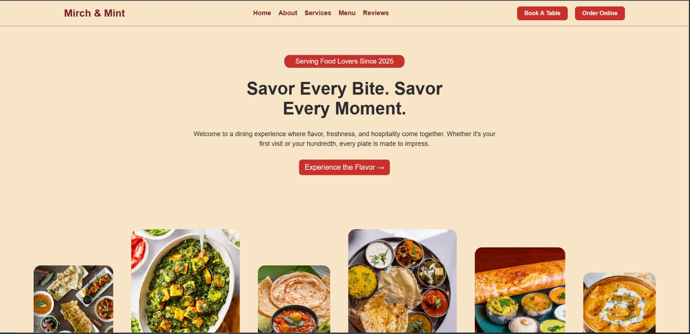

# Mirch & Mint

A responsive restaurant website where you can browse the menu, place an order and book a table. Built with plain HTML, CSS and JavaScript, with no frameworks.

**Live site:** https://mukesh854-cell.github.io/restaurant-website/

## Features

- **Menu** with a category filter and live order summary
- **Cart** with quantity buttons, saved in the browser so it survives page changes
- **Checkout** with a bill (subtotal, 5% tax and total), form checks for name, phone and address, and an order ID
- **Dessert suggestion** after an order is placed
- **Table booking** that checks for double bookings
- **Reviews** with star ratings, saved in the browser
- **Responsive layout** for desktop, tablet and phone, with a hamburger menu on small screens

## Built with

- HTML5
- CSS3 (flexbox, grid, media queries)
- Vanilla JavaScript
- localStorage for saving data
- GitHub Pages for hosting

## Run it on your computer

1. Download or clone this repo.
2. Open `index.html` in your browser. For the best result, use the Live Server extension in VS Code.

## Notes

This is a front-end project. Orders, bookings and reviews are stored in the browser with localStorage, and they are not sent to a server. The contact details in the footer are placeholders.

## What I learned

- Saving and loading data with localStorage
- Handling clicks on many buttons with one listener (event delegation)
- Making a layout work on every screen size with media queries

## Author

Mukesh, BCA student. https://github.com/Mukesh854-cell
